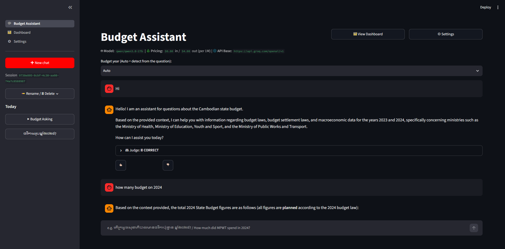
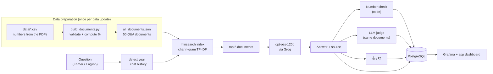
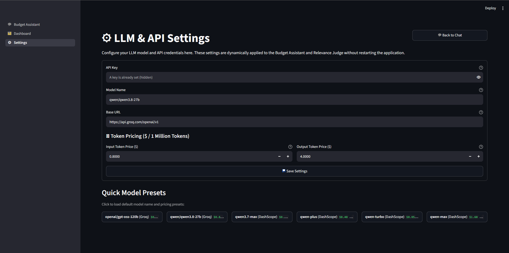
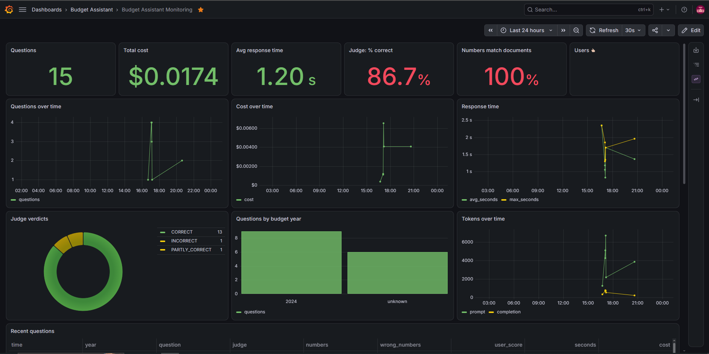
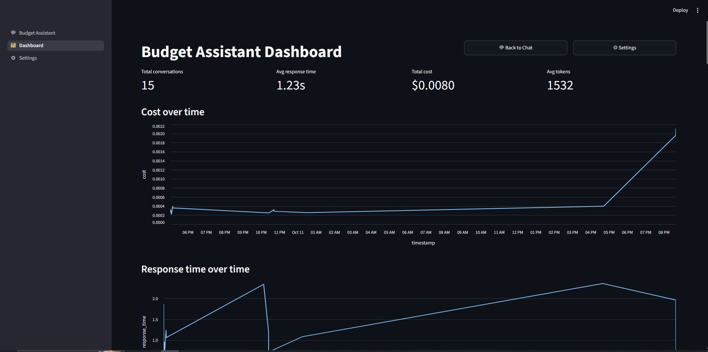

# Cambodia Citizen Budget Assistant

A question-answering assistant about the **Cambodian state budget**, in Khmer and English.
Anyone can ask how much a ministry planned to spend, how much it actually spent, how much
of its budget it executed, how its budget changed from last year, or what share of GDP it is.
Every answer comes with the source document and section, and every answer is checked
automatically against the budget documents.



> **Status of the data.** The figures in `data/*.csv` are **sample values**: 4 budget units,
> 2 years, 50 knowledge-base documents. They exist to build and evaluate the pipeline.
> Replace them with the figures from the official budget laws, settlement laws and
> macroeconomic framework before using the answers. See
> [Adding the real budget data](#adding-the-real-budget-data).

---

## Contents

1. [Problem and domain](#1-problem-and-domain)
2. [Target users and their needs](#2-target-users-and-their-needs)
3. [Ideal output](#3-ideal-output)
4. [Knowledge base](#4-knowledge-base)
5. [How a question is answered](#5-how-a-question-is-answered)
6. [Retrieval system](#6-retrieval-system)
7. [Retrieval evaluation](#7-retrieval-evaluation)
8. [LLM and answer evaluation](#8-llm-and-answer-evaluation)
9. [Success metrics](#9-success-metrics)
10. [Tech stack](#10-tech-stack)
11. [How to run it (for reviewers)](#11-how-to-run-it-for-reviewers)
12. [Monitoring and database](#12-monitoring-and-database)
13. [Project structure](#13-project-structure)
14. [Configuration](#14-configuration)
15. [Hosting](#15-hosting)
16. [Limitations and next steps](#16-limitations-and-next-steps)

---

## 1. Problem and domain

**Domain: the Cambodia citizen budget.** The state budget is published every year in the
**budget law** (ច្បាប់ស្តីពីហិរញ្ញវត្ថុ: what is *planned*) and later in the **budget settlement law**
(ច្បាប់ស្តីពីបញ្ជីទូទាត់ថវិកា: what was *actually* spent and collected). The figures are public,
but they sit in long PDF tables, mostly in Khmer, split across several documents and years.

To answer a simple question such as *"Did the Ministry of Health spend its whole budget in 2024?"*
a citizen has to find two PDFs, find the right table in each, read 13-digit riel amounts and
compute a percentage. Most people never do.

**This project** turns those tables into a searchable knowledge base and answers questions in
plain Khmer or English, with the numbers copied exactly from the documents and the source cited.

## 2. Target users and their needs

Everybody, with a focus on Cambodian citizens. Main groups:

| User | Typical question | What they need from the answer |
|---|---|---|
| Citizens | "How much does the state spend on health this year?" | A short, plain answer in Khmer; one number they can trust |
| Students and teachers | "Which ministry has the largest budget?" | Simple comparisons and rankings, with the source to quote in homework or class |
| Researchers and journalists | "What was MoEYS's execution rate in 2023?" | Exact figures, planned vs actual clearly separated, file and section to cite |
| Data analysts | "How did the MPWT budget change from 2023 to 2024?" | Growth rates and differences already computed, consistent units |
| Economists | "Health budget as a share of GDP in 2024?" | Ratios to GDP and to the total state budget, with the GDP figure used |

**Shared needs:**
- Ask in **Khmer, English or both mixed**. Ministry names are often typed in Khmer inside an English sentence.
- **Exact numbers**. A rounded or invented figure is worse than no answer.
- **Planned vs actual** never mixed up.
- **A source** for every figure: file and section.
- **Follow-up questions** in a chat ("and in 2023?").

## 3. Ideal output

Question: *How much ក្រសួងសាធារណការ និងដឹកជញ្ជូន actual in 2024?*

> ក្រសួងសាធារណការ និងដឹកជញ្ជូនបានចំណាយជាក់ស្តែង 1,519,700,000,000 រៀល ធៀបនឹងច្បាប់ថវិកាដែលបានគ្រោង
> 1,520,000,000,000 រៀល ស្មើនឹងអត្រាអនុវត្ត ៩៩.៩៨%។
>
> The Ministry of Public Works and Transport actually spent **1,519,700,000,000 riel** in 2024, against
> **1,520,000,000,000 riel** planned in the budget law: **99.98% execution**.
>
> Source: budget-law-2024.pdf (table-3.12); settlement-state-2024.pdf (section-4.2)

Properties of an ideal answer:
1. It answers in the language of the question.
2. It names the year, the budget unit and the unit (riel).
3. It says whether each figure is planned (budget law) or actual (settlement law).
4. Its numbers are copied character-for-character from the knowledge base. Percentages are
   pre-computed in the data pipeline, never by the LLM.
5. It cites the file and section.
6. If the knowledge base doesn't contain the answer, it says *"I don't know / ខ្ញុំមិនមានព័ត៌មាននេះទេ"*.

## 4. Knowledge base

### Source documents → tables → Q&A documents

The numbers are not typed as free text. One row of `data/budget_lines.csv` = one number from one PDF:

| Column | Example | Meaning |
|---|---|---|
| budget_year | 2024 | |
| bu_code | MPWT | short stable ID of the budget unit (`STATE` = national total) |
| bu_kh / bu_en | ក្រសួងសាធារណការ និងដឹកជញ្ជូន / Ministry of Public Works and Transport | names as written in the law |
| type | budget / settlement | planned (budget law) or actual (settlement law) |
| metric | expenditure / revenue | |
| amount_riel | 1520000000000 | whole riel |
| file_ref, file_section | budget-law-2024.pdf, table-3.12 | citation |

Two more inputs: `data/macro.csv` (GDP and exchange rate per year) and
`data/aliases.csv` (abbreviations and nicknames such as `MoEYS; ក្រសួងអប់រំ; education ministry`).

`build_documents.py` validates the rows (duplicates, non-numeric amounts, unknown types) and
writes `documents/all_documents.json`. **Every derived number** (execution rate, growth,
share of GDP, share of the state budget, USD conversion, rankings) **is computed in code**,
so the LLM only ever copies numbers.

### Document types

Each document holds **one fact or one comparison**, with a question in English, a question in
Khmer, a bilingual answer and its sources:

| type | one per | answers | in sample |
|---|---|---|---|
| `budget` | year × unit × metric | planned expenditure / revenue | 12 |
| `settlement` | year × unit × metric | actual expenditure / revenue | 12 |
| `execution` | year × unit | actual vs planned, execution rate | 8 |
| `growth` | year × unit | change vs previous year | 4 |
| `gdp` | year × unit | % of GDP, % of total state budget | 8 |
| `macro` | year | GDP, exchange rate | 2 |
| `summary` | year | rankings by budget and by execution rate | 4 |
| **total** | | | **50** |

Example document (abridged):

```json
{
  "id": "2024-mpwt-execution",
  "section": "budget",
  "budget_year": "2024",
  "bu_code": "MPWT",
  "BU": "ក្រសួងសាធារណការ និងដឹកជញ្ជូន",
  "bu_en": "Ministry of Public Works and Transport",
  "type": "execution",
  "question": "How much did Ministry of Public Works and Transport actually spend in 2024 compared to the budget (execution rate)?",
  "question_kh": "តើក្រសួងសាធារណការ និងដឹកជញ្ជូនអនុវត្តថវិកាជាក់ស្តែងបានប៉ុន្មាន ធៀបនឹងថវិកាគ្រោង ក្នុងឆ្នាំ២០២៤?",
  "answer": "… 1,519,700,000,000 រៀល … ៩៩.៩៨% …\nExpenditure: spent 1,519,700,000,000 riel against 1,520,000,000,000 riel planned = 99.98% execution …\nSource: budget-law-2024.pdf (table-3.12); settlement-state-2024.pdf (section-4.2)",
  "keywords": "MPWT; public works; transport ministry; ក.ស.ដ; ក្រសួងសាធារណការ",
  "file_ref": "budget-law-2024.pdf; settlement-state-2024.pdf",
  "expenditure_execution_rate": 99.98
}
```

### Index: budget by year

The index has **text fields** (`question`, `question_kh`, `answer`, `BU`, `bu_en`, `keywords`)
and **keyword fields** used as exact filters (`section`, `budget_year`, `bu_code`, `type`).
The main partition is **the budget year**:
- If the question contains exactly one year, in Western (2024) or Khmer (២០២៤) digits, only that year is searched.
- The year dropdown in the app forces a year.
- In a chat, a follow-up without a year reuses the previous question's year.

## 5. How a question is answered



1. **Retrieve.** Find the year (question, dropdown or previous question), then run a TF-IDF search over character n-grams for the top 5 documents of that year.
2. **Generate.** Send the top 5 documents, the question and the last 3 chat turns to `openai/gpt-oss-120b` on Groq. The instructions say: copy numbers exactly, say planned vs actual, cite the source, reply in the question's language, and say "I don't know" when the documents don't answer.
3. **Check.** Run a **number check** (code) and an **LLM judge**, and accept the user's 👍/👎 (section 8).
4. **Store.** Save the question, answer, tokens, time, cost and checks in PostgreSQL, grouped in chat sessions (UUID).
5. **Monitor.** Show it all in Grafana and on the app's Dashboard page.

## 6. Retrieval system

**Text search** (TF-IDF with cosine similarity, from `minsearch`), over **character 2–4-grams**,
with a **year filter** and **field boosts**. There is no vector database. A hybrid was evaluated
(section 7) but isn't used.

| Setting | Value | Why |
|---|---|---|
| Analyzer | `char_wb`, n-grams 2–4 | Khmer is written without spaces between words, and the default word tokenizer drops Khmer vowel signs: `ក្រសួងសាធារណការ` became `រស`, `ងស`, `រណក`… Character n-grams work for Khmer, English and mixed text without a Khmer word segmenter |
| Filter | `section = budget`, `budget_year = <detected year>` | Budget questions almost always name a year; documents of other years are near-duplicates that would otherwise compete |
| Boosts | question ×3, question_kh ×3, BU ×2, bu_en ×2, keywords ×1.5, answer ×0.5 | Matches on the question and the unit name matter most; answers are long and noisy |
| Top-k | 5 | |

**Why no vector database or embeddings:**
- **Small knowledge base.** At most a few thousand short documents (units × years × types) fit in memory, and TF-IDF over them takes milliseconds.
- **Exact keys.** Questions turn on exact entities (a ministry, a year, planned or actual), which lexical matching handles well.
- **Khmer support.** Few embedding models handle Khmer well, and none could be tested in the build environment.
- **Results.** Text search already scores 0.925 hit@5 on realistic questions. The best hybrid scored 0.950, a difference of one question out of 40 (section 7).

## 7. Retrieval evaluation

**Test sets**
- **Hand-written (40 questions)**, in `data/test_questions.csv`. These are realistic phrasings: Khmer, English, mixed Khmer-English, abbreviations (MoEYS, MPWT, ផ.ស.ស), casual wording, rankings. Some have two acceptable answers (e.g. actual spending → the settlement or the execution document). This is the set that matters.
- **Generated (116 questions)**, in `documents/ground_truth.json`. These are the template questions of each document in English and Khmer, plus a short variant. They are easy, and only catch regressions.

**Metrics:** hit rate@5 is the share of questions whose correct document is in the top 5. MRR@5 is the mean of 1/rank of the correct document.

**Strategies tried** (`python evaluate_retrieval_strategies.py`):

| Strategy | Hand-written (40) hit@5 | MRR | Generated (116) hit@5 | MRR |
|---|---|---|---|---|
| Text, word tokens, course-project setup (question/section/answer, no year filter) | 0.725 | 0.597 | 0.845 | 0.748 |
| Text, word tokens, all budget fields + year filter | 0.825 | 0.655 | 1.000 | 0.989 |
| Text, char 2-4 n-grams, no year filter | 0.775 | 0.675 | 1.000 | 1.000 |
| Text, char 2-4 n-grams + year filter, no boosts | 0.900 | 0.740 | 0.983 | 0.958 |
| Text, char 1-3 n-grams + year filter | 0.625 | 0.482 | 1.000 | 0.933 |
| Text, char 2-5 n-grams + year filter | 0.925 | 0.709 | 1.000 | 1.000 |
| **Text, char 2-4 n-grams + year filter + boosts (used)** | **0.925** | **0.718** | **1.000** | **1.000** |
| Vector, LSA (char TF-IDF + SVD, 100 dims) + year filter | 0.925 | 0.763 | 0.931 | 0.835 |
| Hybrid RRF: used text search + LSA vector | 0.950 | 0.769 | 1.000 | 0.931 |

**What the results show**
- **Character n-grams + the year filter matter most.** Together they move hit@5 on realistic questions from 0.725 (the original course setup) to 0.925.
- **The year filter alone is worth +15 points** with character n-grams (0.775 → 0.925).
- **n-gram size:** 1–3 is too short (0.625); 2–4 and 2–5 tie on hit rate.
- **The hybrid is best on the hand-written set** (+1 question, MRR +0.05), but it lowers ranking quality on the generated set (MRR 1.000 → 0.931). That gain is one question in 40, which is not enough evidence, so the simpler text search stays. The hybrid is ready in `evaluate_retrieval_strategies.py` if a larger test set confirms it.
- **Neural multilingual embeddings** (`paraphrase-multilingual-MiniLM-L12-v2`) are wired into the script. They run automatically when `sentence-transformers` is installed (`uv pip install sentence-transformers`), but they couldn't be downloaded in the build environment, so they have no score here.

**The 3 remaining misses** with the used strategy (`python eval_retrieval.py -v`):

| Question | Expected | Why it misses (checked by rewording the question) |
|---|---|---|
| how much money did the government plan to spend in 2023 | STATE planned expenditure | Casual "plan to spend" matches the execution documents ("actually spend … compared to the budget"). Rewording it as "planned expenditure" finds the right document |
| MPWT budget increase 2024 | MPWT growth | The 4-letter abbreviation "MPWT" carries little weight in character n-grams, so "budget … 2024" pulls the STATE documents up. "public works budget increase 2024" finds MPWT documents |
| What share of the total state budget goes to health in 2024? | MoH share of GDP / state budget | "total state budget" matches the STATE documents more strongly than "health" matches MoH. Without "total state", the MoH document ranks first |

Possible fixes, not yet evaluated:
- Add `bu_code` as a boosted text field, so abbreviations count more.
- Add casual phrasings such as "plan to spend" to the generated questions.
- Rewrite the query with the LLM before searching.

## 8. LLM and answer evaluation

**Model:** `openai/gpt-oss-120b` served by **Groq**, through the OpenAI Python SDK (Responses API).
Groq price as of October 2026: $0.15 / 1M input tokens, $0.60 / 1M output tokens. Any
OpenAI-compatible provider can be used by changing `.env` (DashScope/Qwen, OpenAI, Ollama).

**Prompt** (`rag_helper.py`): answer only from the context, copy numbers exactly, state year, unit
and planned/actual, cite the source, reply in the question's language, "I don't know" when the
context lacks the answer. Earlier chat turns are only for understanding follow-ups.

**Three checks on every answer** (stored in the `feedback` table):

| Check | How | Verdicts |
|---|---|---|
| Number check | Code, no LLM. Every number with 3+ digits in the answer must appear in the retrieved documents (Khmer digits normalised) | OK / MISMATCH (+ missing numbers) / NO_NUMBERS |
| LLM judge | `gpt-oss-120b` reads the question, **the same documents** and the answer | CORRECT / PARTLY_CORRECT / INCORRECT + explanation |
| User feedback | 👍 / 👎 in the app | +1 / −1 |

**Offline LLM evaluation.** `python evaluate_llm.py --limit 10` runs the first 10 hand-written questions
with two prompts and grades every answer with the number check and the judge. One prompt is the
course project's basic prompt, the other the budget prompt in use. The run used
`openai/gpt-oss-120b` on Groq's free plan; 10 questions were used because of the free plan's daily token limit.

| Prompt | CORRECT | PARTLY | INCORRECT | Numbers match docs | Avg time (s) | Cost ($) |
|---|---|---|---|---|---|---|
| basic prompt (course project) | 100% | 0% | 0% | 80% | 7.33 | 0.0026 |
| **budget prompt (used)** | **100%** | **0%** | **0%** | **100%** | 9.93 | 0.0035 |

**What the results show**
- **The judge rated both prompts 100% CORRECT,** so it doesn't tell them apart on these questions.
- **The number check does tell them apart.** With the basic prompt, 20% of answers contained a number that isn't in the documents, typically a rounded or reformatted figure. With the budget prompt, which says to copy numbers exactly, every number matched. For budget data this is the difference that matters, so the budget prompt is used.
- **The cost of the budget prompt:** it is about 2.6 s slower and 35% more expensive, because its answers are longer (bilingual, with source and planned/actual labels).
- **The LLM judge is lenient about exact numbers.** It passed answers that the number check flagged, which is why the app runs both checks.
- **Small sample.** These are 10 questions on sample data; re-run on more questions with the real data.

Per-question answers, verdicts and flagged numbers are in `evaluation/llm_results.csv`.

## 9. Success metrics

| Area | Metric | Target | Current |
|---|---|---|---|
| Retrieval | hit rate@5 on hand-written questions | ≥ 0.90 | **0.925** |
| Retrieval | MRR@5 on hand-written questions | ≥ 0.70 | **0.718** |
| Answers | Judge CORRECT (offline, 10 questions) | ≥ 90% | **100%** |
| Answers | Numbers in answers found in the documents | ≥ 95% | **100%** (offline) |
| Answers | INCORRECT answers | ≤ 2% | **0%** (offline) |
| Users | 👍 share of rated answers | ≥ 80% | Grafana "Users 👍" |
| Speed | Average response time (answer only) | ≤ 5 s | **9.9 s, above target**: gpt-oss-120b reasons before answering; a smaller model or lower reasoning effort could help |
| Cost | Per question (answer + judge) | ≤ $0.001 | Grafana "Total cost" ÷ questions |

The cost target follows from about 1,500 input and 300 output tokens per call, two calls
per question, at Groq's price: about $0.0008.

## 10. Tech stack

| Layer | Choice | Version | Role |
|---|---|---|---|
| Language | Python | ≥ 3.12 | everything |
| Package manager | uv | latest | `pyproject.toml` + `uv.lock` |
| LLM provider | Groq (OpenAI-compatible API) | – | hosts the model |
| LLM | `openai/gpt-oss-120b` | – | answers and judge |
| LLM client | `openai` Python SDK | 3.15.0 | Responses API calls |
| Search / index | `minsearch` (TF-IDF + cosine, scikit-learn) | 0.2.0 | in-memory text index with keyword filters |
| Vector database | **none** | – | not needed at this size (section 6) |
| RAG framework | **none**, plain Python (`rag_helper.py`) | – | the pipeline is ~100 lines; no LangChain or LlamaIndex |
| Web UI | Streamlit | 1.64.0 | chat, dashboard, settings |
| Database | PostgreSQL | 17 (Docker image) | conversations, feedback, chat sessions |
| DB driver | psycopg | 3.3.5 | |
| Monitoring | Grafana | latest image | 17-panel dashboard, provisioned automatically |
| Validation | pydantic | 2.13.5 | judge output schema |
| Containers | Docker + Docker Compose | – | postgres, app, grafana |
| Other | pandas, numpy, scikit-learn, python-dotenv | from `uv.lock` | |

## 11. How to run it (for reviewers)

### Option A: Docker (recommended)

Requirements: Docker Desktop (on Windows with WSL 2) and a Groq API key (console.groq.com/keys).

```bash
# 1. settings
cp .env.example .env            # Windows PowerShell: copy .env.example .env
#    edit .env: OPENAI_API_KEY=gsk_your-key   (everything else is preset for Groq)

# 2. start Postgres + app + Grafana
docker compose --env-file .env up -d --build
docker compose ps               # all three should be "Up"
```

| Open | Address | Login |
|---|---|---|
| Chat app | http://localhost:8501 | – |
| Grafana | http://localhost:3000 | admin / admin |

The app creates the database tables on first start. Try:
- `តើក្រសួងសុខាភិបាលមានថវិកាប៉ុន្មាន ឆ្នាំ២០២៤?`
- `How much did MPWT actually spend in 2024 compared to the budget?`, then the follow-up `and in 2023?`
- `Which ministry has the largest budget in 2024?`

The **Settings** page (hidden when `HIDE_SETTINGS=true`) switches the model, API address and
token prices without restarting. The API key field is never pre-filled:



Fill the dashboards with fake traffic (Ctrl+C to stop):
```bash
docker compose exec streamlit python generate_data.py
```

Stop with `docker compose down`. `docker compose down -v` also deletes the database.

### Option B: app on your machine, database in Docker

```bash
uv sync
docker compose up -d postgres
uv run streamlit run app.py
```

### Reproduce the evaluations

```bash
uv run python build_documents.py                  # rebuild the knowledge base from data/*.csv
uv run python eval_retrieval.py -v                # hit rate / MRR of the used strategy, lists misses
uv run python evaluate_retrieval_strategies.py    # the comparison table in section 7
uv run python evaluate_llm.py --limit 10          # LLM evaluation (needs the API key; waits through rate limits)
uv run python judge.py                            # small number-check + judge demo
```

Without uv, run the same scripts in the app container, mounting the project folder:
`docker compose run --rm -v "$PWD:/work" -w /work streamlit python eval_retrieval.py -v`
(PowerShell: `"${PWD}:/work"`).

### Adding the real budget data

1. Replace the rows in `data/budget_lines.csv`, `data/macro.csv` and `data/aliases.csv`. Save from Excel as **CSV UTF-8** to keep the Khmer text.
2. Run `uv run python build_documents.py`. It stops with a line number if a row is invalid.
3. Run `uv run python eval_retrieval.py -v`, and add real user questions to `data/test_questions.csv`.
4. Restart: `docker compose --env-file .env up -d --build`.

### Common problems

| Error | Fix |
|---|---|
| `failed to connect to the docker API … dockerDesktopLinuxEngine` | Start Docker Desktop and wait for "Engine running" |
| `Bind for 0.0.0.0:5432 failed: port is already allocated` | Another Postgres uses 5432: stop it, or map `"127.0.0.1:5433:5432"` in `docker-compose.yaml` |
| `localhost refused to connect` on 8501 | `docker compose ps -a`, then `docker compose logs streamlit` |
| `Invalid API key` | Fix `.env`, then `docker compose --env-file .env up -d` |
| `make` not found (Windows) | Use the full commands above |
| `429 … Request too large … output tokens per minute` | The model's per-minute limit on your Groq plan is too small (e.g. `qwen/qwen3.8-27b` on the free plan). Use `openai/gpt-oss-120b`, or lower `ANSWER_MAX_TOKENS` / `JUDGE_MAX_TOKENS` |

## 12. Monitoring and database

**PostgreSQL tables**

| Table | One row per | Columns |
|---|---|---|
| `chat_sessions` | chat | id (UUID), title, created_at, updated_at |
| `conversations` | question | question, answer, budget_year, session_id, model, instructions, prompt, prompt/completion/total tokens, response_time, cost, timestamp |
| `feedback` | check | conversation_id, source (`number_check` / `judge` / `user`), relevance (verdict), explanation, score, timestamp |

Tables are created, and older databases upgraded, automatically when the app starts
(`db_init.py`). `python db_init.py --reset` drops them.

**Grafana dashboard "Budget Assistant Monitoring"** (17 panels, loaded automatically from `grafana/`):



- **Usage and cost:** questions, total cost, average response time
- **Quality rates:** % judged CORRECT, % of answers whose numbers match the documents, % 👍
- **Over time:** questions, cost, response time and tokens
- **Breakdowns:** judge verdicts, questions per budget year
- **Tables:** recent questions with all checks, and answers to review (not CORRECT, mismatched numbers, or 👎)
- **Chats:** chats started, questions per chat, recent chats

**The app's own Dashboard page** shows the same basics without Grafana: total questions,
average response time, total cost and tokens, cost and response time over time, and recent
conversations. It's the monitoring view on hosts without Grafana, such as Streamlit Community Cloud.



**Chat sessions.** Each chat gets a UUID on its first question. The URL carries `?session=<uuid>`,
so refresh or bookmark reopens it. The sidebar lists saved chats grouped by Today, Yesterday,
Previous 7 days, Previous 30 days and Older, with rename and delete.

## 13. Project structure

```
data/
  budget_lines.csv        numbers from the budget and settlement laws (input)
  macro.csv               GDP and exchange rate per year (input)
  aliases.csv             abbreviations / nicknames per budget unit (input)
  test_questions.csv      40 hand-written retrieval test questions
documents/
  all_documents.json      generated knowledge base (50 documents)
  ground_truth.json       generated test questions (116)
build_documents.py        CSV → validated Q&A documents, all calculations
ingest.py                 load documents, build the minsearch index (Khmer-aware)
rag_helper.py             year detection, search, follow-ups, prompt, LLM call
metrics.py                LLM call with token, time and cost tracking
assistant.py              wires the pipeline; answers one question from the terminal
judge.py                  number check + LLM judge
evaluation_utils.py       structured LLM output with retries
eval_retrieval.py         hit rate / MRR of the used strategy
evaluate_retrieval_strategies.py   comparison of retrieval strategies (section 7)
evaluate_llm.py           comparison of prompts with judge + number check (section 8)
app.py                    Streamlit app: chat with sessions, dashboard, settings
db_init.py / db_save.py / db_feedback.py / db_query.py / db_sessions.py   PostgreSQL access
generate_data.py          fake traffic for testing the dashboards
grafana/                  Grafana datasource + dashboard (provisioned)
docker-compose.yaml, Dockerfile, pyproject.toml, uv.lock, .env.example
```

## 14. Configuration

All settings are environment variables, read from `.env` (or Streamlit Secrets when hosted).

| Variable | Default / example | Purpose |
|---|---|---|
| `OPENAI_API_KEY` | `gsk_…` | Groq (or other provider) API key |
| `OPENAI_BASE_URL` | `https://api.groq.com/openai/v1` | OpenAI-compatible endpoint |
| `LLM_MODEL` | `openai/gpt-oss-120b` | model for answers and judge |
| `INPUT_TOKEN_PRICE` / `OUTPUT_TOKEN_PRICE` | `0.15` / `0.60` | $ per 1M tokens, for cost tracking |
| `ANSWER_MAX_TOKENS` / `JUDGE_MAX_TOKENS` | `1024` / `512` | max output tokens per call; Groq counts these caps against per-minute limits |
| `POSTGRES_HOST`, `POSTGRES_PORT`, `POSTGRES_DB`, `POSTGRES_USER`, `POSTGRES_PASSWORD` | `localhost`, `5432`, `budget_assistant`, `user`, `password` | database |
| `DATABASE_URL` | – | one connection string for hosted Postgres; overrides the above |
| `HIDE_SETTINGS` | – | `true` hides the Settings page (public hosting) |
| `APP_PASSWORD` | – | asks visitors for a password |
| `SHOW_HISTORY` | on locally, off when `HIDE_SETTINGS=true` | sidebar list of all saved chats |
| `GRAFANA_PASSWORD` | `admin` | Grafana admin password |

Other providers work by changing three lines: DashScope (`qwen3.7-max-2026-06-08`), OpenAI, or
Ollama locally (`OPENAI_BASE_URL=http://host.docker.internal:11434/v1`, `OPENAI_API_KEY=ollama`).

## 15. Hosting

- **Free, no Docker:** Streamlit Community Cloud for the app (dependencies from `uv.lock`) plus a hosted Postgres such as Neon (`DATABASE_URL`). Put the variables in the app's Secrets, with `HIDE_SETTINGS=true` and `APP_PASSWORD`. Grafana isn't available there; use the app's Dashboard page.
- **Own server:** `docker compose up -d --build` on a Linux VPS. Postgres and Grafana listen only on 127.0.0.1. Put a reverse proxy such as Caddy in front of port 8501 for HTTPS.

The API key is never sent to the browser, and the Settings page leaves the key field empty.

## 16. Limitations and next steps

- **Sample data.** Load the official figures (section 11). Extracting tables from Khmer PDFs is manual for now, because the PDFs' fonts often break text extraction.
- **Small test sets.** The 40 retrieval questions and the generated questions come from 4 units and 2 years. Collect real user questions (Grafana's "recent questions" table) and add them to `data/test_questions.csv`.
- **Embeddings untested.** Neural multilingual embeddings and a neural hybrid are implemented but were not scored. Run `evaluate_retrieval_strategies.py` with `sentence-transformers` installed.
- **No user accounts.** Chat history is shared by everyone using one deployment. It's hidden in public mode.
- **The judge uses the same model** that writes the answers. The number check is independent; a second model as judge would be stronger.
- **Retrieval misses:** the 3 remaining ones are fixable with aliases (section 7).